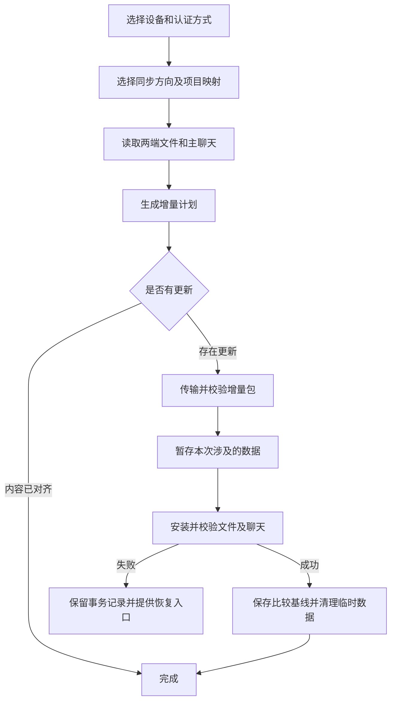

# Codex 项目同步

在 Windows 和 macOS 之间迁移项目文件与 Codex 主聊天。手动选择设备、源项目和目标目录，保存对应关系后，可按需要将另一台电脑的更新接收到本机。

当前版本 **1.0.1**，提供本机浏览器界面、Windows 桌面入口及 macOS 应用入口。同步期间，两台设备需要开机并保持网络连通。完成后，可在本机继续使用项目与聊天。

## 可以做什么

| 功能 | 使用方式 |
| --- | --- |
| 选择设备 | 从 Tailscale 设备列表或局域网邻居中选择，也可手动填写 IP、主机名和 SSH 端口 |
| 登录目标电脑 | 支持用户名和密码、SSH 私钥、SSH agent 与默认密钥 |
| 保存连接 | 保存名称、IP、端口、用户名、系统和认证方式，启动时回填上次选择 |
| 选择项目 | 为每个源项目指定目标已有项目或新目录，支持两端名称与路径不同 |
| 首次迁移 | 复制资料，并将新目录登记为目标电脑上的本地项目 |
| 后续同步 | 比较文件内容及聊天历史，相同内容跳过，领先历史接续 |
| 保留双方修改 | 文件冲突另存，聊天真实分叉时保留分支 |
| Git 历史 | 可选迁移正式分支与标签，默认关闭 |
| 失败恢复 | 安装前暂存本次涉及的数据，提供未完成安装的恢复入口 |

## 环境要求

两台电脑都需要安装本程序，以及系统 Git。密钥模式使用系统 OpenSSH 的 `ssh`、`sftp` 和 `ssh-keyscan`；密码模式使用程序内置的 Paramiko，主机指纹获取仍需 `ssh-keyscan`。

目标电脑需要开启 SSH 服务，并允许当前用户登录。使用密码时，目标 SSH 服务需要允许密码认证。

- **macOS** 可在“系统设置 → 通用 → 共享 → 远程登录”开启 SSH。项目位于“文稿”等受保护目录时，需要授予相关文件访问权限。
- **Windows** 需要启用 OpenSSH Server，并确认 SSH 服务和防火墙允许所选端口。可通过 `Get-Service sshd` 查看服务状态。
- **Tailscale** 模式需要两端登录相互可访问的网络。
- **局域网** 模式填写目标电脑的局域网 IP，并确保 SSH 端口可达。

## 从源码安装

当前仓库提供源码。分别在两台电脑上构建当前平台的运行包。构建需要 Python 3.9 或更新版本，macOS 还需要 Xcode Command Line Tools 提供的 Swift 编译器。

### Windows

在 PowerShell 中执行。

```powershell
git clone https://github.com/zxshm/codex-project-sync.git
cd codex-project-sync
python -m venv .venv
.\.venv\Scripts\python.exe -m pip install -r requirements.txt PyInstaller
.\.venv\Scripts\python.exe build_app.py
```

完成后，桌面会出现 **Codex项目同步** 入口。程序安装到 `%USERPROFILE%\.codex-project-sync\program`，运行时已包含 Python 和密码连接依赖。

### macOS

在终端中执行。如果尚无 Swift 编译器，可先执行 `xcode-select --install` 安装命令行开发工具。

```bash
git clone https://github.com/zxshm/codex-project-sync.git
cd codex-project-sync
python3 -m venv .venv
./.venv/bin/python -m pip install -r requirements.txt PyInstaller
./.venv/bin/python build_app.py
```

完成后，应用位于 `~/Applications/CodexProjectSync.app`，桌面会出现 **Codex项目同步.app** 入口。

也可以在已安装依赖的源码目录中执行 `python main.py` 启动界面。构建 macOS 应用时，运行包采用当前构建环境的架构。

## 第一次迁移，按这个顺序操作

1. **打开两端程序，准备目标电脑。** 确认目标 SSH 已开启，两台电脑保持唤醒。
2. **选择连接。** 在发起端选择 Tailscale 或局域网，选择设备或手动填写地址，确认目标系统、SSH 用户名和端口。
3. **选择认证方式。** 密码模式输入目标账号密码；密钥模式选择本机私钥，或留空使用 SSH agent、默认密钥。
4. **保存连接设置。** 可为设备命名，例如“家里的 Mac”。目标暂时离线时，也可以先保存设置。
5. **核验主机指纹。** 点击“获取并核验主机指纹”，与目标电脑的 ED25519 指纹核对，确认后连接。
6. **选择同步方向。** “接收到本机”表示远端为来源，“发送到所选设备”表示本机为来源。
7. **选择项目与目标。** 勾选源项目，为每项选择目标已有项目，或填写新项目目录。保存映射。
8. **先检查更新。** 查看新增文件、聊天接续、分支与新项目数量，再点击“开始同步”。
9. **等待完成。** 安装涉及聊天或项目登记时，程序会等待接收端聊天生成结束，退出其 Codex，完成校验后重新打开。

核对 macOS SSH 指纹可在目标终端执行。

```bash
ssh-keygen -lf /etc/ssh/ssh_host_ed25519_key.pub
```

Windows 的默认主机公钥通常位于 `C:\ProgramData\ssh\ssh_host_ed25519_key.pub`，读取该文件可能需要管理员权限。

## 以后在两台电脑间交接

假设第一次将 Windows 上的“项目 A”迁移到 Mac。之后在 Mac 上继续工作，回到 Windows 时，打开 Windows 程序，选中已保存的 Mac 连接和项目映射，使用“接收到本机”进行检查和同步。

程序会保存多个设备的连接设置，启动时自动回填上次选择的连接。密码仅保留在本次程序运行内存中，重开程序后重新输入。密钥文件在本机由用户指定，连接记录保存密钥路径。



## 项目、文件与聊天如何比较

项目关系由用户明确选择。两端可以采用不同项目名称、目录结构和磁盘路径，程序根据保存的映射转换项目根目录。

| 两端状态 | 处理结果 |
| --- | --- |
| 文件内容相同 | 跳过传输 |
| 一端新增文件 | 传入接收端 |
| 文件需要更新 | 根据共同基线判断更新或保留冲突文件 |
| 同一聊天历史相同 | 跳过导入 |
| 来源聊天历史领先 | 接续接收端聊天 |
| 接收端聊天历史领先 | 保留接收端较长历史 |
| 双方从共同历史继续出不同内容 | 保留聊天分支 |
| 目标未选项目已占用同一聊天 ID | 为本次迁移建立独立 ID 映射，保留原有归属 |

聊天通过 ID、历史内容及已保存的映射判断关系。标题相同仅提供项目选择时的提示。同步范围包含选定项目的主聊天、相关历史与可恢复附件，侧边聊天排除在外。

旧聊天中的临时图片会优先尝试从日志内嵌数据恢复。必要历史图片确实缺失时，导出会报错，界面会指出缺失路径。

## 临时数据、Git 与恢复

安装前，程序只暂存本次涉及的文件、聊天记录、项目登记和必要索引字段。暂存数据使用 Git 与事务记录支持失败恢复。成功校验后，删除本次临时回退数据和传输包，保留轻量映射及比较基线。

需要恢复时，选择原设备及原项目映射，点击 **恢复未完成安装**，完成恢复后再重新检查更新。

项目本身已有 Git 仓库时，程序使用相应检查点保护修改。普通文件夹保持其原有类型。“额外迁移 Git 正式分支和标签”用于需要源代码历史的项目，默认关闭。额外链接工作树会提示单独处理。

## 数据放在哪里

| 内容 | 位置 |
| --- | --- |
| 程序设置和设备连接 | 用户目录下的 `.codex-project-sync` |
| 每组项目映射与基线 | `.codex-project-sync/contexts/<映射标识>` |
| 主机公钥信任 | `.codex-project-sync/hosts` |
| 实际项目文件 | 用户选择的目标项目目录 |
| Codex 聊天与相关附件 | 目标电脑现有的 `.codex` 数据目录 |

登录凭据、全局插件安装和插件信任使用各端现有配置。程序界面仅监听本机 `127.0.0.1`，操作请求使用随机会话令牌。

## 常见问题

**每次都要重新填 IP 吗？**

点击“保存连接设置”后，设备会出现在顶部列表。重开程序会回填上次选择，列表可以切换其他已保存设备。

**只能用密钥吗？**

认证方式可以选择“用户名和密码”。密码在本次运行期间可继续用于同步，退出程序后重新输入。

**两台电脑都修改了同一聊天怎么办？**

程序比较共同历史。出现真实分叉时保留分支，后续通过保存的映射继续识别。

**为什么同步需要退出接收端 Codex？**

聊天迁移涉及正式数据库、日志和项目登记。退出接收端应用并确认所属后台结束后再安装，可以避免应用同时写入这些数据。

**为什么聊天多时，传输包比项目文件大？**

增量包可能包含聊天日志、图片和附件。勾选 Git 历史时还可能包含缺少的 Git 对象。后续内容已对齐时会跳过重复传输。

## 测试与兼容性

当前已在 Windows x64 和 Intel macOS 上完成构建与运行验证。两端各 57 项回归测试通过，覆盖聊天接续与分叉、侧边聊天排除、目录转换、事务恢复、空聊天项目登记、密码 SSH、SFTP 上传下载及续传。

真实项目迁移验证了文件校验、项目登记、聊天历史、附件以及官方后端读取和恢复会话。密码认证在隔离 SSH 服务和两端安装包中验证。真实反向复测采用已对齐的数据，分叉和失败回滚通过隔离测试覆盖。Windows 所属后台退出补强在该轮真实反向测试中没有触发。

程序会读写 Codex 本机的数据格式，当前代码使用 `state_5.sqlite` 和 `thread_history_1.sqlite` 等存储。Codex 版本变化后需要重新检查格式兼容性。Apple Silicon 原生包尚待实机验收。

运行回归测试。

```bash
python -m unittest -q test_sync test_chat_import test_projects test_connections
```

## 源码结构

| 文件 | 职责 |
| --- | --- |
| `main.py` | 桌面界面与 SSH 接收组件入口 |
| `server.py`、`界面.html` | 本机操作界面、设备设置与任务状态 |
| `runtime.py` | 设备身份、项目枚举和映射 |
| `transport.py` | SSH 认证、主机指纹、SFTP 及设备发现 |
| `project_sync.py` | 双向同步计划、传输和安装协调 |
| `sync_core.py` | 文件比较、聊天历史、附件和事务导入 |
| `controller.py`、`recover.py` | 比较基线、辅助控制与中断恢复 |
| `windows_app.py` | Windows Codex 桌面与所属后台退出检查 |
| `build_app.py`、`mac_launcher.swift` | 当前平台打包安装及 macOS 启动入口 |

提交问题时，请提供操作系统、程序版本、同步方向、项目是否已登记以及脱敏后的错误文字。路径、IP、聊天内容和账号信息可用示例值代替。
